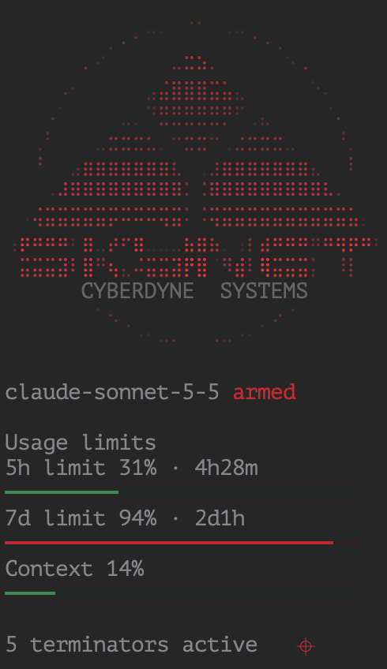

# skynet-panel

A Skynet-themed side panel for Claude Code. It opens a 30-column widget pane
titled "Skynet" that shows a bundled ANSI logo, your model, usage limits and
context usage, and a small status line that reacts to running subagents.



## What the panel shows

- The bundled logo, `skynet-logo-2.ansi.txt`, rendered with its ANSI colors.
- Model line: `<model> armed` (model id in grey, "armed" in red).
- "Usage limits": one bar per rate-limit window (`5h limit`, `7d limit`,
  `Spend`) with the percent used and the time until reset. Shows
  "No limit data yet" until data arrives.
- A "Context" bar with the context percent (only when it is known).
- Bar color by usage: under 70% green, under 90% yellow, otherwise red.
- Status line at the bottom:
  - `N terminators active` with a red crosshair bouncing across a 5-cell
    field while subagents/teammates are running or pending.
  - `searching for targets` with a bouncing dot otherwise.

## Command

- `/ansi <file>` loads an ANSI file and shows it in the pane in place of the logo.
- `/ansi +N` / `/ansi -N` scrolls the shown file down or up by N lines.
- `/ansi` with no argument just opens the pane.

## Install

`.claude-plugin/marketplace.json` defines a marketplace named `skynet-local`
containing one plugin, `skynet-panel`, with source `./` (this directory).
Add this directory as a plugin marketplace in Claude Code, then install the
`skynet-panel` plugin from the `skynet-local` marketplace. Check Claude Code's
`/plugin` command for the exact syntax in your version.

## How it works

`hooks/hooks.json` loads one module, `hooks/register.tsx`, which uses the
`claude-code` plugin API.

- `session.start` registers the `/ansi` command, loads the logo into the `doc`
  atom, opens the pane (id `skynet-panel`, 30 columns, widget placement), and
  starts a 350 ms `clock.every` timer. Each tick counts agents with
  `$.agent.list()` (status `running` or `pending`) and advances the animation
  frame (8 frames).
- `session.end` cancels the timer.
- `session.measure` copies rate limits and context percent into the `meter` atom.
- `ui.render` draws the `Pane` component from the `doc`, `meter` and `activity`
  atoms. The logo is trimmed to the rows left after the usage block.
- `command.run` handles `/ansi`.

## Project layout

```
.claude-plugin/plugin.json       plugin manifest (name, version, types path)
.claude-plugin/marketplace.json  local marketplace listing this plugin
.claude-plugin/types/            claude-code type declarations (.d.ts)
hooks/hooks.json                 declares the hooks module
hooks/register.tsx               all behavior: state, ANSI parsing, command, rendering
types/index.d.ts                 types for this plugin's state (doc, meter, activity)
skynet-logo-2.ansi.txt           bundled ANSI logo (14 lines)
docs/screenshot.png              screenshot used in this README
```

## Notes and limitations

- There is no build or test setup in this repo.
- Type declarations for the plugin API live in `.claude-plugin/types`.
- The animation timer is started in `session.start`, so after `/reload-plugins`
  it may need a new session to resume.
- The crosshair glyph's width depends on the terminal font, so the bounce may
  look uneven in some fonts.
